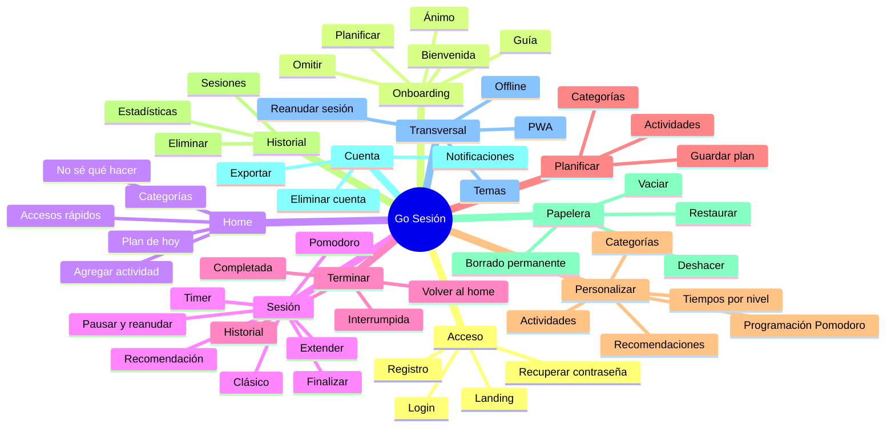
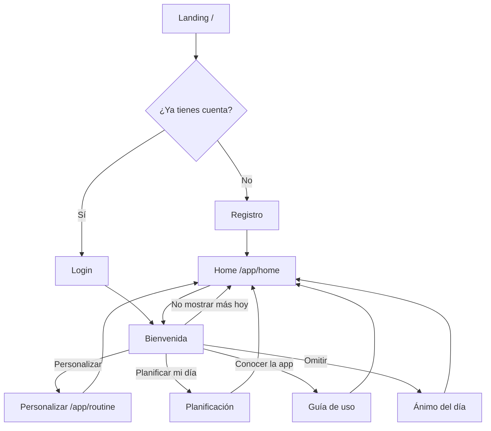
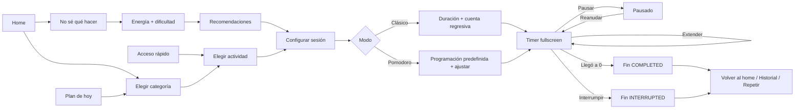
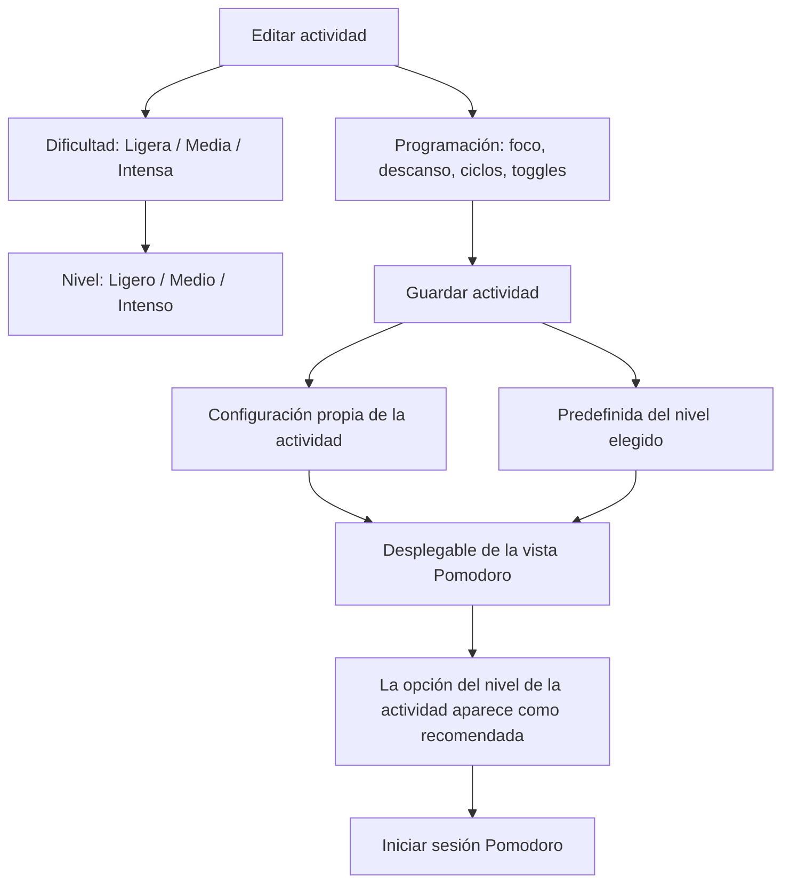
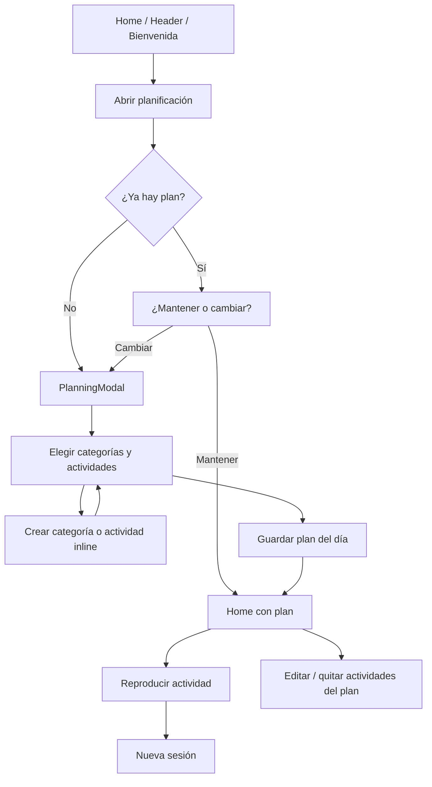
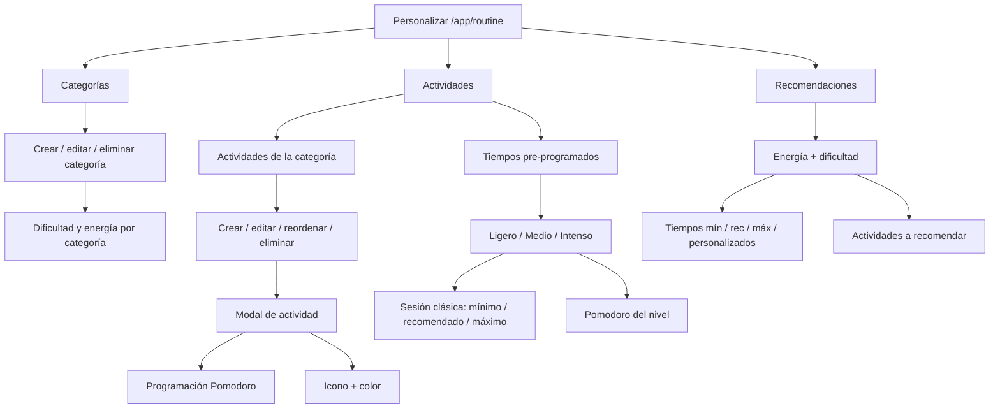
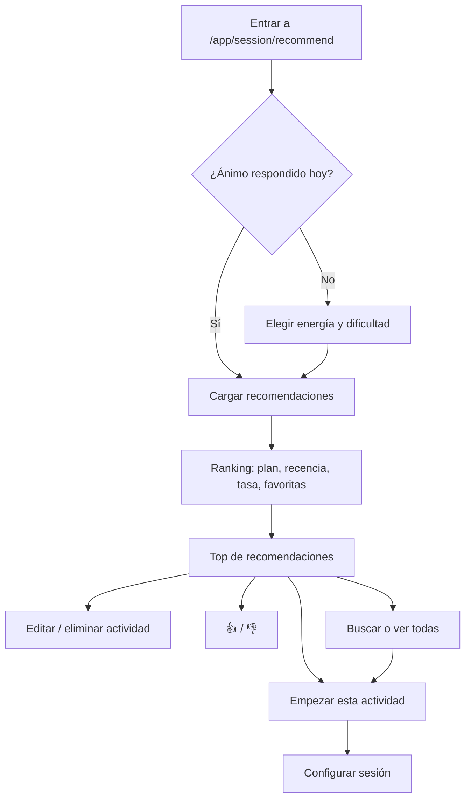
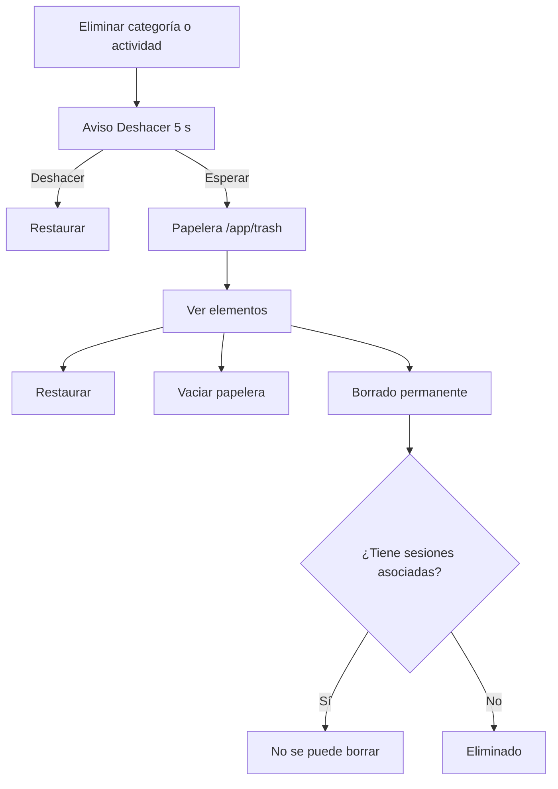
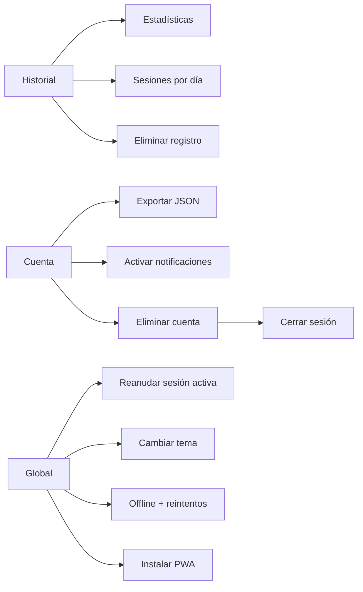

# Mapa mental y flujos de Go Sesión

> Vista rápida de **todas las rutas, entradas y caminos** de la plataforma.
> Los diagramas están en **Mermaid**: GitHub los renderiza automáticamente al abrir este archivo. En VS Code necesitas la extensión *Markdown Preview Mermaid Support* (o pegar el bloque en <https://mermaid.live>).
> También dejé un árbol de texto al inicio para leerlo sin renderizar.

---

## 1. Mapa mental general

```text
GO SESIÓN
│
├── 1. ACCESO
│   ├── Landing pública
│   ├── Registro (crea cuenta + 5 categorías / 13 actividades)
│   ├── Login
│   └── Recuperar contraseña (correo)
│
├── 2. ONBOARDING (solo si es nuevo o no ha visto el aviso del día)
│   ├── Bienvenida
│   ├── Planificar mi día
│   ├── Conocer la app (guía)
│   ├── Ánimo del día (energía)
│   └── Omitir
│
├── 3. HOME (hub diario)
│   ├── Categorías
│   ├── Plan de hoy
│   ├── Accesos rápidos
│   ├── Agregar actividad
│   └── "No sé qué hacer" → recomendación
│
├── 4. EMPEZAR UNA SESIÓN
│   ├── Elegir categoría → actividad
│   ├── Recomendación por energía y dificultad
│   ├── Modo Clásico (tiempo único)
│   ├── Modo Pomodoro (foco / descanso / ciclos)
│   ├── Cuenta regresiva
│   └── Timer fullscreen
│       ├── Pausar / reanudar
│       ├── Extender
│       ├── Finalizar (interrumpir)
│       └── Alarma + notificación
│
├── 5. TERMINAR
│   ├── Completada
│   ├── Interrumpida
│   ├── Volver al home
│   ├── Repetir / recomendaciones
│   └── Historial
│
├── 6. PLANIFICAR
│   ├── Abrir desde Home / Header / Bienvenida
│   ├── Elegir categorías y actividades
│   ├── Crear categoría o actividad inline
│   ├── Editar títulos
│   ├── Quitar actividades
│   └── Guardar plan del día
│
├── 7. PERSONALIZAR
│   ├── Categorías (crear, editar, eliminar)
│   ├── Actividades (crear, editar, reordenar, eliminar)
│   │   └── Editar actividad → Programación Pomodoro
│   ├── Tiempos pre-programados
│   │   ├── Nivel Ligero / Medio / Intenso
│   │   ├── Sesión clásica (mín / rec / máx)
│   │   └── Pomodoro del nivel
│   └── Recomendaciones
│       ├── Energía + dificultad
│       ├── Tiempos (mín / rec / máx / personalizados)
│       └── Qué actividades recomendar
│
├── 8. HISTORIAL
│   ├── Estadísticas (racha, sesiones, minutos, %)
│   ├── Sesiones agrupadas por día
│   └── Eliminar entrada
│
├── 9. PAPELERA
│   ├── Deshacer (5 s)
│   ├── Restaurar
│   ├── Vaciar
│   └── Borrado permanente
│
├── 10. CUENTA
│   ├── Exportar datos (JSON)
│   ├── Notificaciones push
│   └── Eliminar cuenta
│
└── 11. TRANSVERSAL
    ├── Temas (6)
    ├── PWA instalable
    ├── Offline + cola de reintentos
    ├── Reanudar sesión activa
    ├── Preferencias sincronizadas
    └── Seguridad (auth, rate-limit, permisos)
```



---

## 2. Rutas principales

| Ruta | Acceso | Para qué sirve | Sale hacia |
|---|---|---|---|
| `/` | Público | Landing, beneficios, instalación PWA, guía | `/login`, `/register` |
| `/login` | Público | Iniciar sesión | `/app/home` |
| `/register` | Público | Crear cuenta + datos iniciales | `/app/home` |
| `/forgot-password` | Público | Pedir enlace de recuperación | Correo |
| `/reset-password/[token]` | Público | Definir nueva contraseña | `/login` |
| `/app/home` | Privado | Hub: categorías, plan, rápidos, recomendación | Sesión, plan, personalizar |
| `/app/session/recommend` | Privado | "No sé qué hacer": energía, ánimo, ranking | Configurar sesión |
| `/app/session/new?category=` | Privado | Elegir actividad de una categoría | Configurar sesión |
| `/app/session/new?category=&activity=` | Privado | Saltar directo a una actividad | Configurar sesión |
| `/app/session` | Privado | Timer fullscreen de la sesión activa | Fin de sesión |
| `/app/routine` | Privado | Personalizar: categorías, actividades, recomendaciones | Home, sesión |
| `/app/routine?tab=actividades` | Privado | Abrir directo la pestaña Actividades | Actividades |
| `/app/subcategories` | Privado | Gestionar actividades por categoría | Sesión, papelera |
| `/app/history` | Privado | Estadísticas e historial de sesiones | Home, repetir |
| `/app/trash` | Privado | Restaurar o borrar definitivamente | Actividades |
| `/app/account` | Privado | Exportar datos, push, eliminar cuenta | `/login` |
| `/api/auth/[...nextauth]` | Público | Sesión Auth.js | — |

---

## 3. Flujo de entrada y onboarding



**Caminos alternos**
- Si ya respondió el ánimo hoy, no vuelve a preguntarse.
- Si ya existe un plan, al pedir "conocer la app" aparece el aviso *mantener plan / empezar de cero*.
- La bienvenida se puede ocultar por el resto del día.

---

## 4. Ciclo principal: empezar → enfocar → terminar



### Detalle del modo Pomodoro



**Regla actual**
1. La dificultad de la actividad decide su nivel (`Ligera → ligero`, `Media → medio`, `Intensa → intenso`).
2. Lo que configures en **Programación** se guarda en la actividad y también como predefinido de ese nivel.
3. En la vista Pomodoro, el desplegable muestra los 3 niveles y marca el recomendado.
4. Si la actividad tiene configuración propia, esa manda al iniciar.

---

## 5. Planificación diaria



**Estados**
- Sin plan: se abre el modal vacío.
- Con plan: primero se pregunta si mantenerlo o cambiarlo.
- El plan se guarda por día (zona horaria de Lima).
- Las actividades del plan se pueden editar o quitar sin salir del Home.

---

## 6. Personalización



**Puntos clave**
- **Categorías** definen dificultad y energía; alimentan las recomendaciones.
- **Actividades** heredan la dificultad de su categoría, pero se puede cambiar.
- **Tiempos pre-programados** edita los 3 niveles y muestra en dos columnas la sesión clásica y el Pomodoro.
- **Recomendaciones** define qué actividades y tiempos se usan para cada combinación energía + dificultad.
- Los cambios se guardan en `localStorage` y se sincronizan con el servidor.

---

## 7. Recomendación por energía



**Caminos alternos**
- Si no hay coincidencias por energía, se muestran todas.
- `👍` sube la actividad; `👎` la retira.
- Si es de noche, se priorizan sesiones cortas.
- Si ya hay una sesión activa, al iniciar se reutiliza.

---

## 8. Papelera y borrado



**Reglas**
- Retención: 15 días.
- Máximo: 50 elementos.
- Una categoría con actividades no se elimina hasta vaciarla o mover sus actividades.
- El borrado permanente falla si hay historial de sesiones asociado.

---

## 9. Historial, cuenta y acciones transversales



**Acciones globales**
- **Reanudar sesión**: si hay una sesión activa y no estás en el timer, aparece un aviso para continuar o ignorar.
- **Temas**: 6 opciones visuales.
- **PWA**: instalable, con iconos y modo standalone.
- **Offline**: las acciones de preferencias y feedback se encolan y se reintentan.
- **Notificaciones**: permiso al iniciar sesión; push configurable desde Cuenta.

---

## 10. Atajos por intención

| Quiero... | Camino |
|---|---|
| Empezar rápido | Home → categoría → actividad → Iniciar |
| No decidir | Home → "No sé qué hacer" → recomendación → Empezar |
| Seguir mi plan | Home → Plan de hoy → Play |
| Organizar mi día | Header → Planificación |
| Ajustar mis tiempos | Personalizar → Actividades → Tiempos pre-programados |
| Configurar Pomodoro de una actividad | Personalizar → Actividades → Editar → Programación |
| Cambiar qué me recomiendan | Personalizar → Recomendaciones |
| Ver mi progreso | Header → Historial |
| Recuperar algo borrado | Header → Papelera |
| Instalar la app | Landing → Descargar como app |
| Cambiar el tema | Header → selector de tema |
| Exportar mis datos | Cuenta → Exportar mis datos |

---

## 11. Guards y estados que afectan los caminos

| Situación | Efecto |
|---|---|
| Sin sesión | `/app/*` redirige a `/login` |
| Sin `?category` en sesión nueva | Redirige a `/app/home` |
| Categoría inexistente | Redirige a `/app/home` |
| Sesión activa existente | Se reutiliza al iniciar otra |
| Sesión activa fuera del timer | Aparece "Reanudar sesión" |
| Ánimo ya respondido hoy | No se vuelve a preguntar |
| Bienvenida oculta hoy | No aparece de nuevo hasta mañana |
| Plan existente | Se pregunta mantener o cambiar |
| Sin coincidencias por energía | Se muestran todas |
| Categoría con actividades | No se puede eliminar |
| Actividad con historial | No se puede borrar permanentemente |
| Sin conexión | Preferencias y feedback se encolan |

---

*Última actualización: flujos de Personalizar > Actividades, Pomodoro por nivel, recomendación por dificultad y vista fluida sin tabs.*
